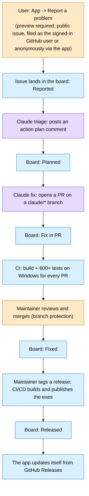

# The automated bug-to-release pipeline

Optimus-Vibe is built and maintained with heavy automation by **Claude** (Anthropic) and GitHub Actions. This page says
plainly what is automated and where a human is still in the loop. Setup details (secrets, tokens, workflows, branch
protection) are in [ci.md](ci.md).

Legend: purple = done automatically by Claude, blue = done automatically by GitHub Actions / the app, orange = a human.

## Steps

| Step | Who | Notes |
|---|---|---|
| Report a problem | User | Public issue. The user previews the exact text first; personal details are stripped ([PRIVACY.md](../PRIVACY.md)). |
| Triage | **Claude (automatic)** | Posts an action-plan comment on the issue and labels it. |
| Fix PR | **Claude (automatic)** | Opens a PR from a `claude/*` branch. Claude never merges. |
| Project board | **Workflows (automatic)** | [Optimus-Vibe - bug squashing](https://github.com/users/jrose462/projects/5): Reported, Planned, Fix in PR, Fixed, Released. Cards move on their own. |
| CI | **GitHub Actions (automatic)** | Build and 600+ tests on Windows for every PR. |
| Review and merge | **Human (maintainer)** | Required by branch protection. |
| Release | **CI/CD (automatic after a tag)** | Builds the self-contained exes, attaches them and [THIRD_PARTY_NOTICES.md](../THIRD_PARTY_NOTICES.md) to a GitHub Release. |
| Update | **The app (automatic)** | Checks GitHub Releases anonymously and updates itself. |

## Game presets

Game presets are also generated by Claude: the `game-settings-recommender` skill researches a game's settings files and
writes per-device presets as YAML into each user's **own private config repo**. They are community-style recommendations,
not guarantees. No game presets are stored in this public repo (only a generic starter in `seed/config/`).

## What this means for you

- Anything you put in a bug report is public and is read by Claude. Review the preview.
- Claude can propose code, but nothing reaches a release without CI passing and the maintainer merging.
