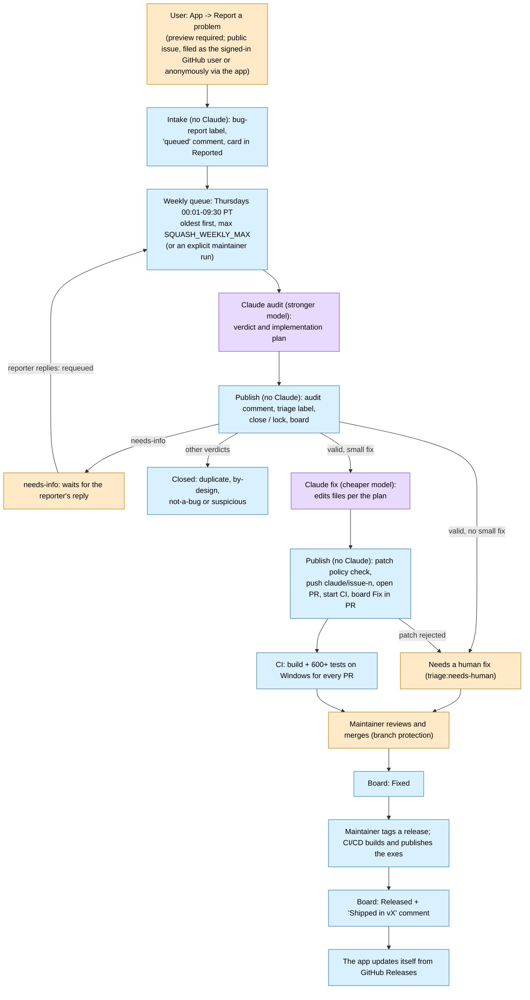

# The automated bug-to-release pipeline

Optimus-Vibe is built and maintained with heavy automation by **Claude** (Anthropic) and GitHub Actions. This page says
plainly what is automated and where a human is still in the loop. Setup details (secrets, tokens, workflows, branch
protection) are in [ci.md](ci.md); the maintainer's weekly routine is in [maintainer-guide.md](maintainer-guide.md).

Legend: purple = Claude (file tools only, no GitHub access), blue = GitHub Actions / the app, orange = a human.

## Steps

| Step | Who | Notes |
|---|---|---|
| Report a problem | User | Public issue. The user previews the exact text first; personal details are stripped ([PRIVACY.md](../PRIVACY.md)). |
| Intake | **GitHub Actions (automatic, any time)** | Labels the issue `bug-report`, comments that it is queued, and puts the card in Reported. No Claude. A reporter's reply to a `needs-info` audit requeues it. |
| Weekly bug squash | **Claude (automatic, Thursdays only)** | Runs Thursdays 00:01-09:30 Pacific, oldest queued issues first, at most `SQUASH_WEEKLY_MAX` (default 10); leftovers wait a week. Keeps Claude usage inside the subscription's weekly window. |
| Audit | **Claude (stronger model)** | Gives a verdict. For a valid small bug it also writes a plan that a smaller model can follow. |
| Fix | **Claude (cheaper model)** | Carries out the plan with file edits only. |
| Publish | **GitHub Actions (no Claude)** | Posts the audit, sets labels and board cards, and for fixes checks the patch against the policy before opening the PR. Claude never opens PRs or comments itself. |
| Explicit runs | **Maintainer (any time)** | Actions "Claude bug squash" → Run workflow (optional issue number), or an `@claude` comment on an issue by an owner, member or collaborator. |
| CI | **GitHub Actions (automatic)** | Build and 600+ tests on Windows for every PR. |
| Review and merge | **Human (maintainer)** | Required by branch protection. |
| Release | **CI/CD (automatic after a tag)** | Builds the self-contained exes, attaches them and [THIRD_PARTY_NOTICES.md](../THIRD_PARTY_NOTICES.md) to a GitHub Release. |
| Update | **The app (automatic)** | Checks GitHub Releases anonymously and updates itself. |

## Game presets

Game presets are also generated by Claude: the `game-settings-recommender` skill researches a game's settings files and
writes per-device presets as YAML into each user's **own private config repo**. They are community-style recommendations,
not guarantees. No game presets are stored in this public repo (only a generic starter in `seed/config/`).

## What this means for you

- Anything you put in a bug report is public and is read by Claude during the weekly bug squash. Review the preview.
- Claude can propose code, but nothing reaches a release without CI passing and the maintainer merging.
